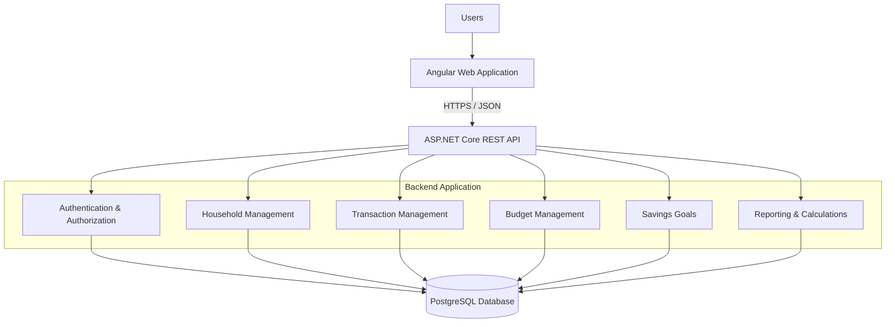
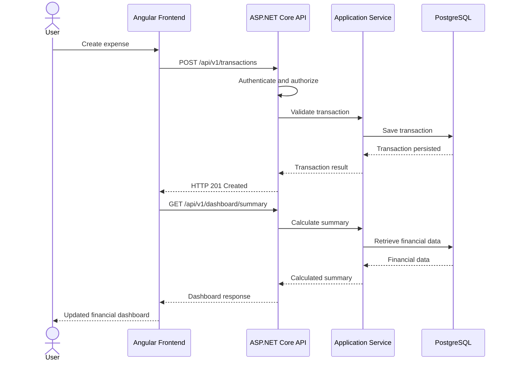
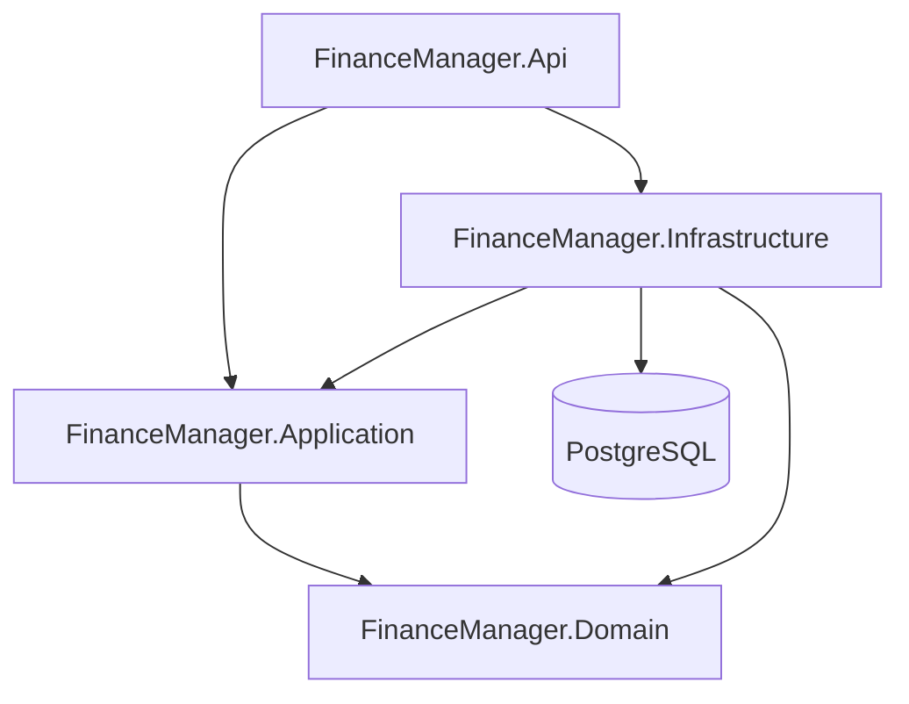
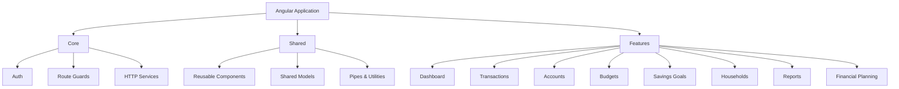
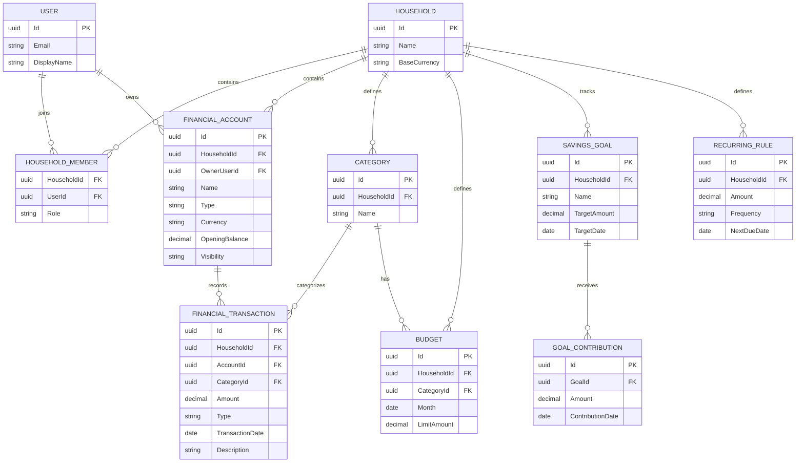
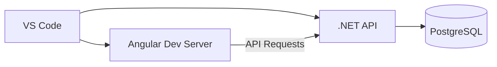
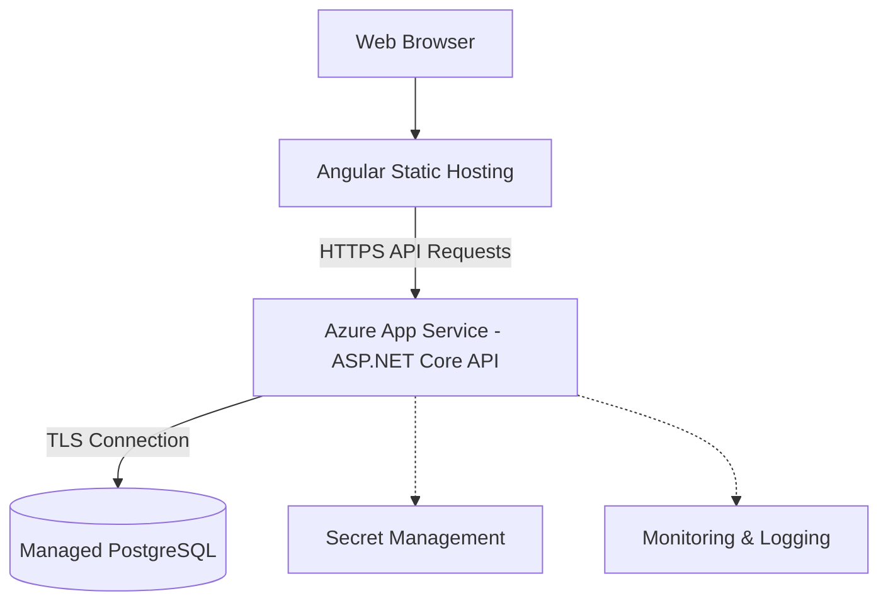
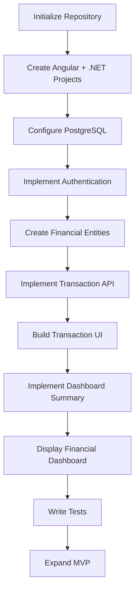

# Finance Manager

### Personal & Household Financial Management Platform

> A modern financial management application that helps individuals and households track income, control expenses, manage budgets, achieve savings goals, and make informed financial decisions.

**Project Status:** Planning / MVP Development  
**Architecture:** Modular Monolith with Clean Architecture Principles  
**Frontend:** Angular + TypeScript  
**Backend:** ASP.NET Core Web API (.NET 10)  
**Database:** PostgreSQL  
**ORM:** Entity Framework Core  
**Primary IDE:** Visual Studio Code  
**Initial Platform:** Responsive Web Application  
**Future Platforms:** iOS, Android, AI-powered Web Application

---

# Table of Contents

1. [Project Overview](#1-project-overview)
2. [Problem Statement](#2-problem-statement)
3. [Product Vision](#3-product-vision)
4. [Target Users](#4-target-users)
5. [MVP Scope](#5-mvp-scope)
6. [Functional Requirements](#6-functional-requirements)
7. [User Stories and Use Cases](#7-user-stories-and-use-cases)
8. [Application Screens](#8-application-screens)
9. [System Architecture](#9-system-architecture)
10. [Technology Stack](#10-technology-stack)
11. [Backend Architecture](#11-backend-architecture)
12. [Frontend Architecture](#12-frontend-architecture)
13. [Database Design](#13-database-design)
14. [Financial Calculation Engine](#14-financial-calculation-engine)
15. [REST API Design](#15-rest-api-design)
16. [Project Folder Structure](#16-project-folder-structure)
17. [Development Environment Setup](#17-development-environment-setup)
18. [Running the Application](#18-running-the-application)
19. [Security and Privacy](#19-security-and-privacy)
20. [Testing Strategy](#20-testing-strategy)
21. [Development Roadmap](#21-development-roadmap)
22. [Future Enhancements](#22-future-enhancements)
23. [Deployment Strategy](#23-deployment-strategy)
24. [Development Standards](#24-development-standards)
25. [Definition of Done](#25-definition-of-done)

---

# 1. Project Overview

Finance Manager is a personal and household financial management platform designed to centralize financial information and provide actionable insights.

The application enables users to:

- Track multiple income sources.
- Record and categorize expenses.
- Monitor bank, cash, savings, and credit accounts.
- Create monthly budgets.
- Monitor recurring bills.
- Collaborate on household finances.
- Set and track savings goals.
- Calculate available disposable income.
- Allocate money between savings and investments.
- Analyze monthly financial performance.
- Evaluate hypothetical financial decisions.
- Forecast future financial positions.

The initial MVP will be developed for personal use by two household members.

The long-term objective is to evolve the project into a scalable financial management SaaS application.

## Project Objectives

1. Create a centralized financial overview.
2. Reduce reliance on spreadsheets and manual calculations.
3. Improve household financial planning.
4. Enable consistent savings and expense tracking.
5. Build a secure foundation for banking integrations.
6. Support future AI-powered financial insights.
7. Design the application for future web and mobile expansion.

---

# 2. Problem Statement

Many individuals and households struggle to maintain a complete understanding of their financial position.

Financial information is often distributed across:

- Bank accounts
- Credit cards
- Savings accounts
- Investment platforms
- Payment applications
- Spreadsheets
- Bills and subscriptions

As a result, users frequently struggle to answer:

- How much do I earn each month?
- How much am I spending?
- What percentage of income am I saving?
- How much disposable income do I have?
- Can I afford higher housing expenses?
- How much should I allocate toward investments?
- Which expense categories are consuming the most money?
- How long will reaching my savings goal take?
- How should household expenses be divided?
- Am I improving financially from month to month?

## Proposed Solution

Finance Manager will consolidate financial activity into a centralized platform.

The system will transform manually entered financial data into:

- Financial summaries
- Spending breakdowns
- Budget tracking
- Savings projections
- Financial reports
- Goal progress
- Cash flow forecasts
- Household financial insights

The MVP will use manually entered transactions.

Future versions will introduce automatic financial data synchronization through supported banking integrations.

---

# 3. Product Vision

## Short-Term Vision

Build a reliable financial dashboard that allows two users to track finances and manage shared expenses.

## Medium-Term Vision

Introduce automated transaction imports, enhanced financial planning, and AI-powered analysis.

## Long-Term Vision

Create a secure financial management platform supporting:

- Individuals
- Couples
- Families
- Multiple financial accounts
- Automated banking connections
- Investments
- Debt management
- AI financial assistance
- Mobile applications
- Subscription-based services

## Core Product Principles

**Simplicity**

Financial data should be understandable without specialized accounting knowledge.

**Accuracy**

Financial calculations must be consistent and testable.

**Privacy**

Users must control who can access their financial information.

**Security**

Financial data requires strong authentication, authorization, and encryption.

**Extensibility**

Future features should build on the existing application rather than require a complete rewrite.

**Automation**

Reduce manual financial tracking where practical.

---

# 4. Target Users

## 4.1 Individual User

Needs:

- Income tracking
- Expense tracking
- Savings management
- Monthly budgeting
- Personal financial dashboard

## 4.2 Household / Couple

Needs:

- Shared household finances
- Individual accounts
- Shared accounts
- Household expense tracking
- Contribution tracking
- Joint savings goals

## 4.3 Multiple-Income Earner

Needs:

- Salary tracking
- Freelance income
- Contract income
- Side-business income
- Variable income forecasting

## 4.4 Goal-Oriented Saver

Needs:

- Savings targets
- Goal deadlines
- Monthly contribution calculations
- Savings progress tracking

## 4.5 Future SaaS User

Needs:

- Secure account registration
- Cloud data storage
- Multiple devices
- Automated bank synchronization
- Financial insights
- Mobile access

---

# 5. MVP Scope

The MVP focuses on one complete problem:

**Enable individuals and households to record financial activity, understand monthly cash flow, and manage savings goals.**

## 5.1 MVP Modules

| Module                 | Description                                  | Priority |
| ---------------------- | -------------------------------------------- | -------- |
| Authentication         | Registration, login, logout                  | P0       |
| Household Management   | Create and join households                   | P0       |
| Financial Accounts     | Track account balances                       | P0       |
| Income Management      | Track multiple income sources                | P0       |
| Expense Management     | Record and categorize expenses               | P0       |
| Transaction Management | Manage income, expense, and transfer records | P0       |
| Dashboard              | Display financial summaries                  | P0       |
| Budget Management      | Create monthly spending limits               | P0       |
| Savings Goals          | Track savings targets                        | P0       |
| Recurring Transactions | Track predictable income and bills           | P1       |
| Financial Reports      | Monthly and category analysis                | P1       |
| CSV Import / Export    | Import and export transactions               | P1       |

### Priority Definitions

- **P0:** Required for the initial usable MVP.
- **P1:** Added after the core workflow is stable.
- **P2:** Future enhancement.

## 5.2 MVP Exclusions

The following are not required for the initial MVP:

- Live banking integrations
- AI financial assistant
- Automated investment trading
- Credit score integrations
- Mobile native applications
- Subscription payments
- Tax filing
- Cryptocurrency trading
- Multi-currency reconciliation
- Automated financial advice

These features can be introduced later.

---

# 6. Functional Requirements

## FR-01: User Authentication

The system shall allow users to:

- Register an account.
- Log in securely.
- Log out.
- Manage account information.
- Change passwords.
- Reset forgotten passwords.
- Access only authorized financial information.

## FR-02: Household Management

The system shall allow users to:

- Create a household.
- Invite another user.
- Accept or reject invitations.
- View household members.
- Configure member roles.
- Manage shared financial information.
- Maintain private financial information.

Initial roles:

- Household Owner
- Household Member

All access permissions must be enforced on the backend.

## FR-03: Financial Account Management

The system shall allow users to create accounts such as:

- Chequing
- Savings
- Credit Card
- Cash
- Investment Tracking

Each account includes:

- Account ID
- Account name
- Account type
- Currency
- Opening balance
- Current calculated balance
- Owner
- Household association
- Visibility

Current balances should be derived from opening balances and recorded transactions.

## FR-04: Income Management

Users can record:

- Employment income
- Freelance income
- Business income
- Side-gig income
- Other income

Income records include:

- Amount
- Date
- Source
- Account
- Category
- Description
- Recurrence information, if applicable

## FR-05: Expense Management

Users can:

- Add expenses.
- Modify expenses.
- Remove expenses.
- Assign categories.
- Search transactions.
- Filter by dates.
- Filter by category.
- View monthly expenses.
- View individual or shared spending.

Example expense categories:

- Housing
- Utilities
- Transportation
- Insurance
- Groceries
- Restaurants
- Entertainment
- Healthcare
- Subscriptions
- Debt Payments
- Miscellaneous

## FR-06: Budget Management

Users can:

- Create monthly budgets.
- Assign spending limits to categories.
- View actual spending.
- View remaining budgets.
- Identify overspending.

Example:

Monthly restaurant budget: $250

Actual spending: $180

Remaining budget: $70

## FR-07: Savings Goal Management

Users can:

- Create savings goals.
- Define target amounts.
- Define deadlines.
- Track contributions.
- View goal progress.
- Calculate required monthly savings.

Example:

Goal: $10,000

Current savings: $2,000

Remaining: $8,000

Deadline: 8 months

Required savings: $1,000 per month.

## FR-08: Dashboard

The dashboard shall display:

- Total monthly income
- Total monthly expenses
- Net cash flow
- Available account balances
- Savings rate
- Budget usage
- Spending by category
- Recent transactions
- Savings goal progress
- Upcoming recurring expenses

## FR-09: Financial Projections

Users can simulate:

- Increased income
- Decreased income
- Higher rent
- Reduced expenses
- Different savings allocations
- Different investment allocations

Simulations must not modify actual financial records.

## FR-10: Reporting

The system shall generate:

- Monthly income reports
- Monthly expense reports
- Category spending reports
- Cash flow trends
- Savings progress reports

---

# 7. User Stories and Use Cases

## UC-01: Record an Expense

**Actor:** Authenticated User

**Description:**

The user records a financial expense.

**Preconditions:**

- User is authenticated.
- User has access to at least one financial account.

**Main Flow:**

1. User navigates to Transactions.
2. User selects Add Transaction.
3. User chooses Expense.
4. User enters the amount.
5. User selects an account.
6. User selects a category.
7. User enters a date.
8. User saves the transaction.
9. Backend validates the request and authorization.
10. Transaction is persisted.
11. Financial summaries reflect the new expense.

**Expected Result:**

The expense is recorded and reflected in account balances and financial reporting.

## UC-02: Create Monthly Budget

**Actor:** Authenticated User

**Main Flow:**

1. User opens Budgets.
2. User selects a category.
3. User enters a monthly spending limit.
4. User saves the budget.
5. System calculates actual spending.
6. System displays remaining budget.

## UC-03: Create Savings Goal

**Actor:** Authenticated User

**Main Flow:**

1. User opens Savings Goals.
2. User creates a goal.
3. User enters target amount.
4. User specifies a deadline.
5. User records contributions.
6. System displays progress.
7. System calculates remaining monthly contribution requirements.

## UC-04: Household Collaboration

**Actors:** Household Owner and Household Member

**Main Flow:**

1. User creates a household.
2. User invites another member.
3. Member accepts invitation.
4. Both users access authorized shared records.
5. Each member can maintain private records.
6. Household dashboard displays shared financial activity.

## UC-05: Financial Scenario Simulation

**Actor:** Authenticated User

**Main Flow:**

1. User opens Financial Planning.
2. User selects baseline income and expenses.
3. User modifies hypothetical values.
4. System calculates projected cash flow.
5. System displays projected savings and investment capacity.
6. User compares scenarios.

**Expected Result:**

The financial simulation does not change actual transactions.

---

# 8. Application Screens

## 8.1 Login and Registration

Features:

- Email input
- Password input
- Registration
- Login
- Forgot password
- Validation feedback

## 8.2 Dashboard

Components:

- Income summary card
- Expense summary card
- Net cash flow card
- Savings rate card
- Cash flow line chart
- Expense category chart
- Budget progress
- Recent transactions
- Savings goal progress

Example layout:

```text
+----------------------------------------------------------+
| Finance Manager                              User Profile |
+-------------+--------------------------------------------+
|             | Dashboard                                  |
| Dashboard   |                                            |
| Accounts    | +------------+ +------------+ +----------+ |
| Transactions| | Income     | | Expenses   | | Cash Flow| |
| Budgets     | | $5,500     | | $3,200     | | $2,300   | |
| Goals       | +------------+ +------------+ +----------+ |
| Reports     |                                            |
| Planning    | +----------------------+ +---------------+ |
| Settings    | | Monthly Cash Flow    | | Spending      | |
|             | |                      | | Categories    | |
|             | |    Line Chart        | | Pie Chart     | |
|             | |                      | |               | |
|             | +----------------------+ +---------------+ |
|             |                                            |
|             | +----------------------------------------+ |
|             | | Recent Transactions                    | |
|             | +----------------------------------------+ |
+-------------+--------------------------------------------+
```

## 8.3 Transactions

Components:

- Transactions table
- Date range selector
- Category filter
- Account filter
- Search input
- Add transaction button
- Edit transaction
- Delete transaction
- Pagination

## 8.4 Budgets

Components:

- Monthly budget overview
- Category spending limits
- Spending progress bars
- Remaining budget
- Overspending indicators

## 8.5 Savings Goals

Components:

- Goals list
- Goal progress cards
- Target dates
- Contributions
- Goal completion projections

## 8.6 Financial Planning

Components:

- Monthly income input
- Monthly expense input
- Savings allocation slider
- Investment allocation slider
- Goal target
- Forecast results

## 8.7 Household Settings

Components:

- Household information
- Members
- Invitations
- Account visibility
- Shared expenses
- Permissions

---

# 9. System Architecture

## 9.1 High-Level Architecture



## 9.2 Architectural Style

The application will use a **Modular Monolith** with **Clean Architecture principles**.

Advantages:

- Simple deployment
- Lower infrastructure cost
- Clear module separation
- Easier debugging
- Easier testing
- Reduced operational complexity
- Supports future scalability

Microservices are not required for the MVP.

## 9.3 Request Flow



---

# 10. Technology Stack

## Frontend

| Technology             | Purpose                     |
| ---------------------- | --------------------------- |
| Angular                | Application framework       |
| TypeScript             | Type-safe programming       |
| Angular Material       | UI components               |
| SCSS                   | Styling                     |
| Angular Router         | Navigation                  |
| Angular HttpClient     | API communication           |
| Angular Signals / RxJS | State and asynchronous data |
| Chart.js               | Financial charts            |
| ng2-charts             | Angular chart integration   |
| Vitest                 | Unit testing                |

## Backend

| Technology                             | Purpose              |
| -------------------------------------- | -------------------- |
| C#                                     | Backend language     |
| ASP.NET Core 10                        | Web API              |
| Entity Framework Core 10               | ORM                  |
| ASP.NET Core Identity                  | Authentication       |
| PostgreSQL Provider                    | Database integration |
| OpenAPI                                | API specifications   |
| Swagger UI                             | API exploration      |
| xUnit                                  | Unit testing         |
| FluentValidation / Built-in Validation | Request validation   |

## Database

**PostgreSQL**

Reasons:

- Relational data structure
- ACID transactions
- Foreign-key constraints
- Reliable financial aggregations
- Strong indexing and querying
- Open source
- Supports managed cloud deployment

## Development Tools

- Visual Studio Code
- Git
- GitHub
- .NET CLI
- Angular CLI
- Node.js
- npm
- PostgreSQL
- Postman or Bruno
- Docker (optional)

## Future Infrastructure

- Azure App Service
- Managed PostgreSQL
- GitHub Actions
- Azure Key Vault
- Monitoring and logging
- Managed backups

---

# 11. Backend Architecture

## 11.1 Project Layers



## Domain Layer

Contains:

- Business entities
- Value objects
- Enumerations
- Business invariants
- Domain rules

Examples:

```text
Entities/
    Household.cs
    FinancialAccount.cs
    FinancialTransaction.cs
    Category.cs
    Budget.cs
    SavingsGoal.cs
    GoalContribution.cs
```

## Application Layer

Contains:

- Application services
- Interfaces
- Use cases
- DTOs
- Commands
- Queries
- Validation

Example:

```text
Features/
    Transactions/
        Commands/
            CreateTransaction/
            UpdateTransaction/
            DeleteTransaction/
        Queries/
            GetTransactions/
            GetTransactionById/
```

## Infrastructure Layer

Contains:

- EF Core DbContext
- Database configurations
- Database migrations
- Identity persistence
- Repository implementations
- External integrations

## API Layer

Contains:

- REST controllers
- HTTP configuration
- Authentication configuration
- Dependency injection
- Middleware
- API error handling

---

# 12. Frontend Architecture

Angular will use a feature-based architecture.



## Frontend Responsibilities

**Components**

Render UI and handle user interaction.

**Services**

Communicate with the backend and coordinate feature-specific operations.

**Models**

Define TypeScript interfaces and request/response types.

**Guards**

Protect routes and support navigation authorization.

**Interceptors**

Handle common HTTP concerns such as errors and appropriate authentication handling.

**State**

Use Angular Signals for local reactive state and RxJS for asynchronous workflows.

A global state-management library is not required initially.

---

# 13. Database Design

## 13.1 Entity Relationship Diagram



This diagram represents the initial conceptual model. Additional foreign keys, transfer relationships, visibility rules, and auditing fields will be added during implementation.

## 13.2 Important Database Rules

### Monetary Values

Use PostgreSQL `numeric`, mapped to C# `decimal`.

Example:

```csharp
public decimal Amount { get; set; }
```

Avoid floating-point calculations for authoritative money values.

### Transactions

Financial transactions should use an explicit transaction type:

```text
Income
Expense
Transfer
```

Transfers between accounts must not count as income or expenses.

### Currency

Store an ISO currency code such as:

```text
CAD
USD
EUR
```

The MVP will initially calculate financial reports in CAD.

Multi-currency conversions will be introduced later.

### Account Balances

Balances should be derived from:

```text
Opening Balance
+ Account Inflows
- Account Outflows
= Current Balance
```

Credit and liability accounts need consistent sign conventions.

### Household Privacy

All financial data queries must verify:

1. Authenticated user
2. Household membership
3. Required permission
4. Ownership or visibility rules

A household member must not automatically receive access to another member's private accounts.

---

# 14. Financial Calculation Engine

The financial calculation engine will be implemented in the backend.

It will contain deterministic calculations that can be independently unit-tested.

## 14.1 Net Cash Flow

```text
Net Cash Flow = Total Income - Total Expenses
```

Example:

```text
Income:   $5,500
Expenses: $3,200

Net Cash Flow = $2,300
```

## 14.2 Savings Rate

```text
Savings Rate =
Savings Contributions / Net Income * 100
```

Example:

```text
Monthly Income: $5,500
Savings:        $1,380

Savings Rate = 25.09%
```

Savings contributions must not also be counted as ordinary expenses.

## 14.3 Budget Remaining

```text
Remaining Budget =
Category Budget - Actual Category Spending
```

## 14.4 Savings Goal Calculation

```text
Remaining Goal =
Target Amount - Current Savings

Monthly Required Contribution =
Remaining Goal / Months Remaining
```

## 14.5 Emergency Fund Coverage

```text
Emergency Fund Months =
Available Emergency Savings / Essential Monthly Expenses
```

## 14.6 Debt-to-Income Ratio

```text
Debt-to-Income Ratio =
Monthly Debt Payments / Gross Monthly Income * 100
```

## 14.7 Savings and Investment Allocation

```text
Available Surplus =
Net Income - Expenses

Savings Contribution =
Available Surplus * Savings Allocation Percentage

Investment Contribution =
Available Surplus * Investment Allocation Percentage
```

Example:

```text
Income:            $5,500
Expenses:          $3,200

Surplus:           $2,300

Savings:           60%
Investments:       40%

Monthly Savings:   $1,380
Monthly Investing: $920
```

## 14.8 Projection Engine

Future calculations include:

- Monthly savings projections
- Goal completion estimates
- Variable income planning
- Affordability scenarios
- Emergency fund forecasts
- Debt repayment forecasts

Projections should expose assumptions and distinguish estimates from actual financial data.

---

# 15. REST API Design

All endpoints will use the base path:

```text
/api/v1
```

## Authentication

| Method | Endpoint         | Description  |
| ------ | ---------------- | ------------ |
| POST   | `/auth/register` | Register     |
| POST   | `/auth/login`    | Login        |
| POST   | `/auth/logout`   | Logout       |
| GET    | `/auth/me`       | Current user |

## Households

| Method | Endpoint                   | Description      |
| ------ | -------------------------- | ---------------- |
| GET    | `/households`              | Get households   |
| POST   | `/households`              | Create household |
| GET    | `/households/{id}`         | Get household    |
| POST   | `/households/{id}/invites` | Invite member    |

## Financial Accounts

| Method | Endpoint         | Description    |
| ------ | ---------------- | -------------- |
| GET    | `/accounts`      | Get accounts   |
| POST   | `/accounts`      | Create account |
| GET    | `/accounts/{id}` | Get account    |
| PUT    | `/accounts/{id}` | Update account |

## Transactions

| Method | Endpoint             | Description               |
| ------ | -------------------- | ------------------------- |
| GET    | `/transactions`      | Get filtered transactions |
| POST   | `/transactions`      | Create transaction        |
| GET    | `/transactions/{id}` | Get transaction           |
| PUT    | `/transactions/{id}` | Update transaction        |
| DELETE | `/transactions/{id}` | Delete transaction        |

## Budgets

| Method | Endpoint        | Description   |
| ------ | --------------- | ------------- |
| GET    | `/budgets`      | List budgets  |
| POST   | `/budgets`      | Create budget |
| PUT    | `/budgets/{id}` | Update budget |
| DELETE | `/budgets/{id}` | Delete budget |

## Savings Goals

| Method | Endpoint                    | Description      |
| ------ | --------------------------- | ---------------- |
| GET    | `/goals`                    | List goals       |
| POST   | `/goals`                    | Create goal      |
| GET    | `/goals/{id}`               | Get goal         |
| PUT    | `/goals/{id}`               | Update goal      |
| POST   | `/goals/{id}/contributions` | Add contribution |

## Dashboard and Planning

| Method | Endpoint                 | Description        |
| ------ | ------------------------ | ------------------ |
| GET    | `/dashboard/summary`     | Summary            |
| GET    | `/reports/cash-flow`     | Cash flow report   |
| GET    | `/reports/spending`      | Spending report    |
| POST   | `/projections/cash-flow` | Financial scenario |

## Example Transaction Request

```json
{
  "accountId": "00000000-0000-0000-0000-000000000001",
  "categoryId": "00000000-0000-0000-0000-000000000002",
  "type": "Expense",
  "amount": 75.5,
  "currency": "CAD",
  "transactionDate": "2026-10-13",
  "description": "Groceries"
}
```

## Example Transaction Response

```json
{
  "id": "00000000-0000-0000-0000-000000000003",
  "type": "Expense",
  "amount": 75.5,
  "currency": "CAD",
  "description": "Groceries",
  "transactionDate": "2026-10-13"
}
```

The API will use consistent error responses, validation, pagination, and backend authorization.

---

# 16. Project Folder Structure

```text
finance-manager/
|
|-- frontend/
|   |-- finance-web/
|       |-- src/
|           |-- app/
|               |-- core/
|               |   |-- auth/
|               |   |-- guards/
|               |   |-- interceptors/
|               |   |-- services/
|               |
|               |-- shared/
|               |   |-- components/
|               |   |-- models/
|               |   |-- pipes/
|               |
|               |-- features/
|               |   |-- dashboard/
|               |   |-- transactions/
|               |   |-- accounts/
|               |   |-- budgets/
|               |   |-- income/
|               |   |-- goals/
|               |   |-- households/
|               |   |-- reports/
|               |   |-- planning/
|               |
|               |-- app.config.ts
|               |-- app.routes.ts
|
|-- backend/
|   |-- FinanceManager.slnx
|   |
|   |-- FinanceManager.Api/
|   |   |-- Controllers/
|   |   |-- Middleware/
|   |   |-- Program.cs
|   |
|   |-- FinanceManager.Application/
|   |   |-- DTOs/
|   |   |-- Interfaces/
|   |   |-- Services/
|   |   |-- Features/
|   |
|   |-- FinanceManager.Domain/
|   |   |-- Entities/
|   |   |-- Enums/
|   |   |-- Rules/
|   |
|   |-- FinanceManager.Infrastructure/
|       |-- Persistence/
|       |-- Configurations/
|       |-- Repositories/
|       |-- Migrations/
|
|-- tests/
|   |-- FinanceManager.UnitTests/
|   |-- FinanceManager.IntegrationTests/
|
|-- docs/
|   |-- requirements.md
|   |-- architecture.md
|   |-- api-contract.md
|
|-- .gitignore
|-- README.md
```

---

# 17. Development Environment Setup

## 17.1 Prerequisites

Install:

- Visual Studio Code
- Git
- Node.js LTS compatible with your Angular version
- npm
- Angular CLI
- .NET 10 SDK
- PostgreSQL
- C# Dev Kit VS Code extension
- Angular Language Service VS Code extension
- ESLint extension
- Prettier extension

Official links:

- https://code.visualstudio.com/
- https://nodejs.org/
- https://angular.dev/
- https://dotnet.microsoft.com/
- https://www.postgresql.org/

Verify installations:

```bash
node --version
npm --version
dotnet --version
git --version
psql --version
```

## 17.2 Initialize Repository

```bash
mkdir finance-manager
cd finance-manager

git init

mkdir frontend backend tests docs

code .
```

## 17.3 Create Angular Application

```bash
npm install -g @angular/cli

cd frontend

ng new finance-web \
  --routing \
  --style=scss \
  --standalone \
  --skip-git

cd finance-web
```

Install Angular Material:

```bash
ng add @angular/material
```

Install chart libraries:

```bash
npm install chart.js ng2-charts
```

Run frontend:

```bash
npm start
```

Default URL:

```text
http://localhost:4200
```

## 17.4 Create .NET Backend

From the repository root:

```bash
cd backend

dotnet new sln -n FinanceManager

dotnet new webapi -n FinanceManager.Api
dotnet new classlib -n FinanceManager.Domain
dotnet new classlib -n FinanceManager.Application
dotnet new classlib -n FinanceManager.Infrastructure
```

Add projects:

```bash
dotnet sln add FinanceManager.Api
dotnet sln add FinanceManager.Domain
dotnet sln add FinanceManager.Application
dotnet sln add FinanceManager.Infrastructure
```

Configure project references:

```bash
dotnet add FinanceManager.Application reference FinanceManager.Domain

dotnet add FinanceManager.Infrastructure reference FinanceManager.Domain
dotnet add FinanceManager.Infrastructure reference FinanceManager.Application

dotnet add FinanceManager.Api reference FinanceManager.Application
dotnet add FinanceManager.Api reference FinanceManager.Infrastructure
```

## 17.5 Install Entity Framework Core

```bash
cd FinanceManager.Infrastructure

dotnet add package Microsoft.EntityFrameworkCore --version "10.*"

dotnet add package Npgsql.EntityFrameworkCore.PostgreSQL --version "10.*"

dotnet add package Microsoft.EntityFrameworkCore.Design --version "10.*"
```

Return to the API project:

```bash
cd ../FinanceManager.Api

dotnet add package Microsoft.EntityFrameworkCore.Design --version "10.*"
```

Install EF tooling:

```bash
dotnet tool install --global dotnet-ef --version "10.*"
```

## 17.6 Set Up PostgreSQL

Connect as a PostgreSQL administrative user.

Create a development user and database:

```sql
CREATE USER finance_app
WITH PASSWORD 'replace-with-strong-local-password';

CREATE DATABASE finance_manager
OWNER finance_app;
```

Configure the database connection string using .NET User Secrets.

From `backend/FinanceManager.Api`:

```bash
dotnet user-secrets init
```

Then:

```bash
dotnet user-secrets set \
  "ConnectionStrings:DefaultConnection" \
  "Host=localhost;Port=5432;Database=finance_manager;Username=finance_app;Password=YOUR_LOCAL_PASSWORD"
```

Do not commit database passwords to Git.

## 17.7 Configure Entity Framework Core

Create a `FinanceDbContext` in the Infrastructure project.

Register it in the API dependency injection configuration.

Example:

```csharp
using Microsoft.EntityFrameworkCore;
using FinanceManager.Infrastructure.Persistence;

builder.Services.AddDbContext<FinanceDbContext>(options =>
{
    options.UseNpgsql(
        builder.Configuration.GetConnectionString(
            "DefaultConnection"));
});
```

The DbContext, required entities, configurations, and registration must be implemented before generating migrations.

Once configured, create a migration from the `backend` folder:

```bash
dotnet ef migrations add InitialCreate \
  --project FinanceManager.Infrastructure \
  --startup-project FinanceManager.Api \
  --context FinanceDbContext
```

Apply migration:

```bash
dotnet ef database update \
  --project FinanceManager.Infrastructure \
  --startup-project FinanceManager.Api \
  --context FinanceDbContext
```

## 17.8 Configure Angular API Proxy

Create:

```text
frontend/finance-web/proxy.conf.json
```

Contents:

```json
{
  "/api": {
    "target": "https://localhost:7001",
    "secure": false,
    "changeOrigin": true
  }
}
```

Update port `7001` to the API's actual local HTTPS port.

Run Angular:

```bash
ng serve --proxy-config proxy.conf.json
```

Angular services can now use relative API URLs:

```typescript
this.http.get("/api/v1/dashboard/summary");
```

## 17.9 Create Initial Angular Features

From `frontend/finance-web`:

```bash
ng generate component features/dashboard/pages/dashboard

ng generate component features/transactions/pages/transaction-list

ng generate component features/accounts/pages/account-list

ng generate component features/budgets/pages/budget-overview

ng generate component features/goals/pages/goals-list

ng generate service core/services/api
```

Configure navigation in `app.routes.ts`.

---

# 18. Running the Application

## Start Backend

From the project root:

```bash
dotnet run --project backend/FinanceManager.Api
```

The terminal will print the available HTTP and HTTPS listening URLs.

## Start Frontend

Open another VS Code terminal:

```bash
cd frontend/finance-web

ng serve --proxy-config proxy.conf.json
```

Open:

```text
http://localhost:4200
```

## Local Development Flow



The backend must have a valid database connection before database-dependent API endpoints can operate.

---

# 19. Security and Privacy

Financial data requires careful security design.

## Authentication

Use ASP.NET Core Identity for:

- Password hashing
- User registration
- Authentication
- Account management
- Password reset

Prefer secure HttpOnly cookie-based authentication for the first-party web application, with CSRF protection where appropriate.

## Authorization

Verify ownership and permissions for every requested resource.

Examples:

- Users cannot retrieve unrelated accounts.
- Members cannot access another user's private transactions.
- Household invitations must be validated.
- Household roles determine administrative permissions.

## Transport Security

Use HTTPS in production.

## Sensitive Data

Never store:

- Plaintext passwords
- Bank login credentials
- API secrets in source control

## Database Protection

- Restrict database access.
- Use least-privilege credentials.
- Maintain encrypted backups.
- Test data restoration.
- Avoid sensitive data in application logs.

## API Security

- Input validation
- Authorization checks
- Rate limiting
- Consistent error handling
- Secure authentication sessions
- Structured logging without financial secrets

## Financial Privacy

Users should have explicit control over personal versus shared financial information.

---

# 20. Testing Strategy

Testing should be part of development from the first milestone.

## 20.1 Unit Tests

Test:

- Net cash flow
- Savings rate
- Budget remaining
- Goal projections
- Account balance calculations
- Financial transfers
- Business validation rules

## 20.2 Integration Tests

Test:

- Creating a transaction
- Retrieving transactions
- Database persistence
- Authorization
- Household isolation
- Transaction updates
- Dashboard aggregation

## 20.3 Frontend Tests

Test:

- Transaction forms
- Input validation
- Financial summary components
- Budget progress
- Savings goal calculations and display
- Error states
- Loading states

## 20.4 Example Test Scenarios

| Scenario                        | Expected Result                             |
| ------------------------------- | ------------------------------------------- |
| Income $5,000, expenses $3,000  | Net cash flow $2,000                        |
| Budget $500, spending $350      | Remaining $150                              |
| Goal $10,000, saved $4,000      | Remaining $6,000                            |
| Transfer $500 between accounts  | Total assets unchanged                      |
| Unauthorized household access   | Access denied                               |
| Invalid negative expense amount | Validation error                            |
| Duplicate imported transaction  | Duplicate detected                          |
| Zero income savings rate        | Defined no-income result, no divide-by-zero |

---

# 21. Development Roadmap

## Milestone 1 — Project Foundation

**Estimated Duration:** Week 1

Tasks:

- [ ] Initialize Git repository
- [ ] Create Angular application
- [ ] Create ASP.NET Core solution
- [ ] Configure project references
- [ ] Install EF Core
- [ ] Configure PostgreSQL
- [ ] Define initial entities
- [ ] Create database migrations
- [ ] Configure logging
- [ ] Add development documentation

**Deliverable:** Frontend, backend, and database foundation.

## Milestone 2 — Authentication and Households

**Estimated Duration:** Week 2

Tasks:

- [ ] Configure ASP.NET Core Identity
- [ ] Implement registration
- [ ] Implement login
- [ ] Implement logout
- [ ] Implement protected routes
- [ ] Create household
- [ ] Invite household members
- [ ] Configure permissions
- [ ] Test household isolation

**Deliverable:** Two users can securely access a shared household.

## Milestone 3 — Accounts and Transactions

**Estimated Duration:** Weeks 3–4

Tasks:

- [ ] Financial account CRUD
- [ ] Transaction CRUD
- [ ] Income categories
- [ ] Expense categories
- [ ] Account transfers
- [ ] Transaction filtering
- [ ] Account balance calculations
- [ ] Backend unit tests
- [ ] Integration tests

**Deliverable:** Users can manage their financial records.

## Milestone 4 — Budgets and Dashboard

**Estimated Duration:** Weeks 5–6

Tasks:

- [ ] Monthly budget CRUD
- [ ] Spending aggregation
- [ ] Dashboard summary endpoint
- [ ] Cash flow chart
- [ ] Expense category chart
- [ ] Recent transaction list
- [ ] Budget progress components
- [ ] Recurring expense tracking

**Deliverable:** Working monthly financial overview.

## Milestone 5 — Savings Goals and Planning

**Estimated Duration:** Week 7

Tasks:

- [ ] Savings goal CRUD
- [ ] Goal contribution tracking
- [ ] Monthly contribution calculations
- [ ] Savings progress display
- [ ] Savings / investment allocation calculator
- [ ] Financial scenario simulation
- [ ] Projection tests

**Deliverable:** Financial planning and savings features.

## Milestone 6 — MVP Release

**Estimated Duration:** Week 8

Tasks:

- [ ] Resolve critical defects
- [ ] Improve responsive design
- [ ] Implement CSV export
- [ ] Run authorization tests
- [ ] Add production configuration
- [ ] Configure CI/CD
- [ ] Configure database backups
- [ ] Deploy application
- [ ] Verify monitoring and health checks

**Deliverable:** Deployed personal finance MVP.

The timeline is an estimate for a focused part-time development effort and can change based on implementation complexity.

---

# 22. Future Enhancements

## Phase 2 — Banking Integrations

Potential features:

- Read-only bank account connections
- Automatic transaction synchronization
- Transaction import reconciliation
- Automatic categorization
- Duplicate detection
- Recurring payment detection
- Balance synchronization

Potential Canadian-compatible integration providers should be evaluated based on supported institutions, pricing, data permissions, and availability.

Bank credentials should never be collected directly by Finance Manager.

## Phase 3 — AI Financial Assistant

Potential capabilities:

- Natural-language financial questions
- Monthly spending summaries
- Spending anomaly explanations
- Savings recommendations
- Financial scenario analysis
- Budget optimization suggestions

Example questions:

> How much did we spend on restaurants last month?

> Can we afford increasing rent by $300?

> How can we save an additional $500 monthly?

> What is our average monthly transportation cost?

AI should interpret financial information and provide explanations.

Financial calculations should remain deterministic and independently testable.

## Phase 4 — Advanced Financial Planning

Potential features:

- Net worth tracking
- Debt management
- Debt snowball calculator
- Debt avalanche calculator
- Investment tracking
- Emergency fund planning
- Long-term financial forecasting
- Multi-currency support
- Historical income analysis
- Financial trend detection

## Phase 5 — Mobile Applications

Potential approach:

- Angular-based responsive web app
- Progressive Web App (PWA)
- Capacitor for mobile packaging
- Native mobile integrations when needed

## Phase 6 — SaaS Commercialization

Potential capabilities:

- Subscription plans
- Paid premium features
- Organization and household tiers
- Administrative dashboard
- Billing integration
- Account lifecycle management
- Compliance and privacy controls
- Infrastructure monitoring
- Tenant isolation

---

# 23. Deployment Strategy

## MVP Deployment

Recommended components:



## Deployment Responsibilities

### Frontend

Deploy Angular production build to a static hosting platform.

### Backend

Deploy ASP.NET Core API to Azure App Service or another managed container/application host.

### Database

Use a managed PostgreSQL instance with backups.

### CI/CD

Use GitHub Actions to:

1. Restore dependencies.
2. Build Angular.
3. Build .NET.
4. Run unit tests.
5. Run integration tests.
6. Publish build artifacts.
7. Deploy approved changes.

### Secrets

Use environment-specific secrets and managed secret storage.

### Monitoring

Track:

- Failed API requests
- Application exceptions
- Database connection errors
- Slow queries
- Authentication failures
- Service availability

---

# 24. Development Standards

## Backend Conventions

- Use C# naming conventions.
- Use asynchronous database operations.
- Separate controllers from business logic.
- Keep domain logic independent of infrastructure.
- Prefer dependency injection.
- Use DTOs for API contracts.
- Validate inputs.
- Return appropriate HTTP status codes.
- Avoid placing business logic directly in controllers.
- Write tests for financial calculations.

## Frontend Conventions

- Use standalone Angular components.
- Organize code by feature.
- Use typed API models.
- Use reusable components for common UI.
- Use Angular Material where appropriate.
- Avoid duplicating API logic.
- Handle loading, empty, and error states.
- Maintain accessible UI controls.
- Support responsive screen sizes.

## Database Conventions

- Use migrations for schema changes.
- Define foreign-key constraints.
- Create appropriate indexes.
- Use decimal monetary values.
- Record creation and modification timestamps.
- Apply ownership and authorization consistently.
- Avoid destructive production migrations without review.

## Git Branching

Suggested naming:

```text
main
develop

feature/authentication
feature/transactions
feature/dashboard
feature/budgets
feature/savings-goals

bugfix/transaction-validation
```

For a solo project, `main` plus short-lived feature branches is also sufficient.

## Commit Naming

Examples:

```text
feat: add transaction creation endpoint

feat: implement dashboard summary

fix: correct account balance calculation

test: add savings projection tests

refactor: extract financial calculation service

docs: update architecture documentation
```

---

# 25. Definition of Done

The MVP is complete when the following conditions are met.

## Authentication

- [ ] Users can register and log in.
- [ ] Sessions are secured.
- [ ] Unauthorized access is denied.

## Household Management

- [ ] Users can create households.
- [ ] Users can invite members.
- [ ] Household permissions work correctly.
- [ ] Private financial data remains private.

## Transactions

- [ ] Users can create income transactions.
- [ ] Users can create expense transactions.
- [ ] Users can edit and delete transactions.
- [ ] Users can transfer money between accounts.
- [ ] Account balances are accurate.

## Budgets

- [ ] Users can create monthly budgets.
- [ ] Actual spending is calculated accurately.
- [ ] Remaining budgets update correctly.

## Dashboard

- [ ] Income summary works.
- [ ] Expense summary works.
- [ ] Cash flow calculations work.
- [ ] Charts display accurate data.
- [ ] Recent transactions display correctly.

## Savings Goals

- [ ] Users can create savings goals.
- [ ] Users can track contributions.
- [ ] Progress calculations are accurate.
- [ ] Goal forecasts work.

## Quality

- [ ] Financial calculation unit tests pass.
- [ ] Critical integration tests pass.
- [ ] Authorization tests pass.
- [ ] No critical security issues remain.
- [ ] Application works on desktop and mobile.
- [ ] Application can be deployed.
- [ ] Database backup and restoration are verified.

---

# Initial Development Focus

The first implementation should follow this sequence:



## First Working Feature

The first complete vertical slice should allow a user to:

1. Log in.
2. Create a financial account.
3. Add an expense transaction.
4. Save the transaction through the .NET API.
5. Persist the record in PostgreSQL.
6. Retrieve an updated financial summary.
7. Display the updated dashboard in Angular.

This establishes the main application workflow:

**Angular → ASP.NET Core → Application Services → PostgreSQL → Dashboard**

Once this workflow is stable, expand into budgets, savings goals, recurring transactions, and household collaboration.

---

# Project Success Criteria

Finance Manager should provide:

- A trustworthy financial overview.
- Accurate account and transaction calculations.
- Simple income and expense tracking.
- Shared household financial planning.
- Savings and budgeting tools.
- Secure user and financial data management.
- A maintainable software architecture.
- A foundation for future automation and AI integration.

## Long-Term Goal

Evolve Finance Manager from a personal project into a secure, extensible financial management platform that helps individuals and households make better financial decisions.

---

**Finance Manager — Plan Better. Spend Smarter. Save Consistently.**
